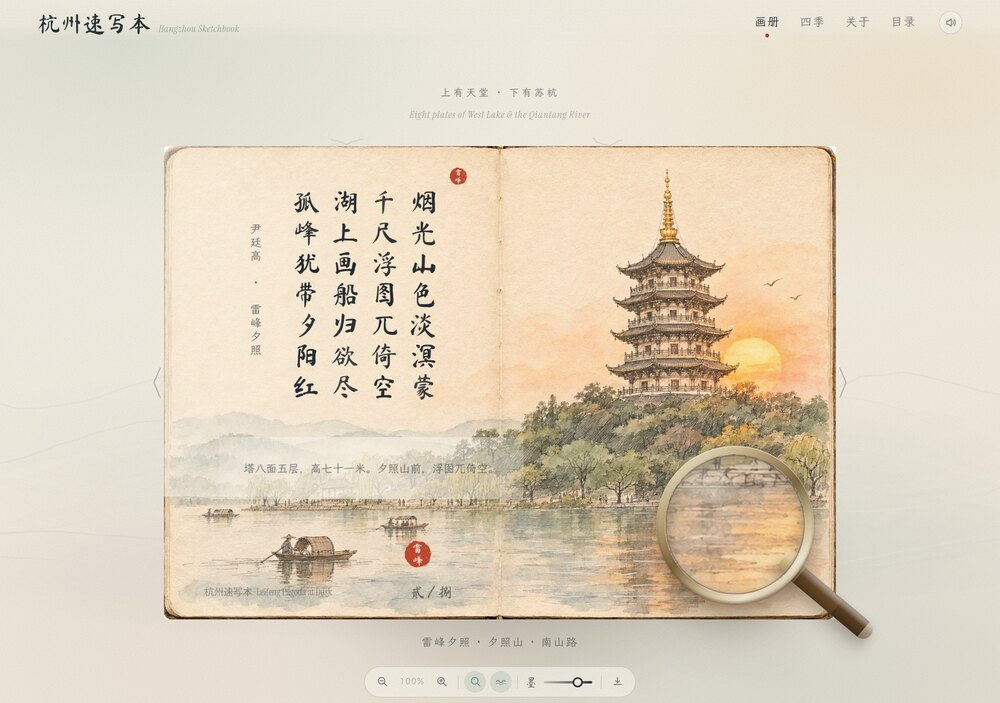
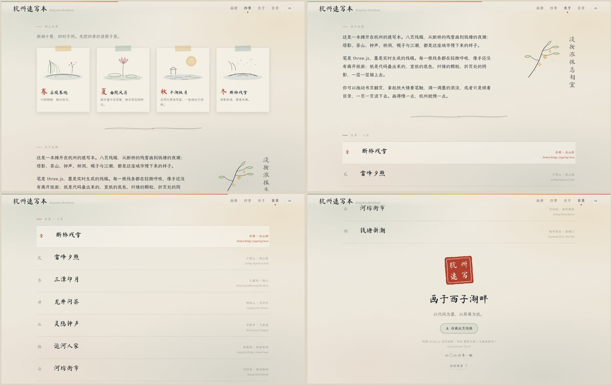

# 杭州速写本 · Hangzhou Sketchbook

> 一本摊开在杭州的速写本。八页**原创手绘旅行插画**，从断桥的残雪画到钱塘的夜潮。
> 以代码为墨，以屏幕为纸。



一个致敬 [MengTo / threeui sketchbook](https://threeui.com/landing-pages/meng-to-sketchbook-landing-page) 手翻速写本气质的杭州主题落地页。保留原版纸张质感、曲面翻页与可拖拽放大镜。八页插画为 **Painter 逐张生成的原创高分辨率钢笔淡彩旅行手帖**（统一画风与纸色、地标可辨识、原创构图而非描摹新加坡原图），作为页面纹理接入；three.js 退为一层透明的轻微动态叠层（水面微光与浮尘）与首屏远山底景。城市内容全部换成杭州：地标、街区、文化意象与文案，配真实咏杭州古诗。

## 线上演示

- **Vercel（production）**：<https://sonic-comet-snlyrjh.tmp.now>
- **源码**：<https://github.com/dingyi/hangzhou-sketchbook>

## 八页

| 序 | 页 | 景 | 诗 |
| --- | --- | --- | --- |
| 壹 | 断桥残雪 | 白堤 · 北山街 | 苏轼《饮湖上初晴后雨》 |
| 贰 | 雷峰夕照 | 夕照山 · 南山路 | 尹廷高《雷峰夕照》 |
| 叁 | 三潭印月 | 小瀛洲 · 湖心 | 张宁《三潭印月》 |
| 肆 | 龙井问茶 | 狮峰山 · 龙井村 | 苏轼《次韵曹辅寄壑源试焙新芽》 |
| 伍 | 灵隐钟声 | 灵隐寺 · 飞来峰 | 宋之问《灵隐寺》 |
| 陆 | 运河人家 | 拱宸桥 · 桥西直街 | 皮日休《汴河怀古》 |
| 柒 | 河坊街市 | 河坊街 · 南宋御街 | 柳永《望海潮》 |
| 捌 | 钱塘新潮 | 城市阳台 · 钱塘江 | 柳永《望海潮》 |


## 交互

- **曲面翻页**：拖动书页、左右箭头、方向键、目录跳转。掀起的书页是 18 条嵌套 strips 组成的真实曲面（移植自原版），带光照渐变与中缝阴影。
- **放大镜**：可拖拽的放大镜实时放大插画笔触（高分辨率合成图，放大依旧清晰），翻页时被书页推开（触屏自动隐藏）。
- **画册工具条**：缩放、放大镜开关、线条呼吸开关、**墨色浓淡滑杆**（实时调整插画墨色）、收藏当前页高清 PNG。
- **纸声**：WebAudio 合成的翻页纸声，默认开启，顶栏一键静音并显示状态。
- **滚动叙事**：湖上四季卡片、关于此册、目录、跋尾印章盖印；固定导航带当前态与锚点偏移、顶部进度条、首屏远山底景视差。
- **无障碍**：完整尊重 `prefers-reduced-motion`（跳过开场 riffle、关闭动态叠层、印章直显）；键盘可翻页；语义化标签与 `aria` 状态。




## 技术栈

- **原创插画**：Painter 逐张生成的钢笔淡彩旅行手帖 PNG（优化为 WebP，共约 4MB），统一暖白纸色与线稿 / 水彩画风
- **页面合成**（`src/art.js`）：2D canvas 将插画铺满跨页，精确叠印竖排诗笺、款识、跋、朱文印与页码；合成图同时用于显示、翻页纸面、放大镜与高清导出，保证一致与清晰
- **[three.js](https://threejs.org)**：透明动态叠层（水面微光 / 浮尘，随「线条呼吸」开关）+ 首屏远山底景；`LineSegments2` 像素级线宽 + 低频 boil
- **[Vite](https://vite.dev)** + 原生 JavaScript（无框架）
- **自托管子集字体**（零外部请求）：霞鹜文楷（正文）、马善政楷书（标题）、Caveat、Instrument Serif、Newsreader
- 响应式，桌面与移动均无横向溢出；生产构建控制台无错误无警告

## 本地运行

```bash
npm install
npm run dev        # 开发服务器 http://localhost:5173
npm run build      # 生产构建到 dist/
npm run preview    # 预览生产构建
npm run fonts      # 重新生成字体子集（需 Python fonttools + brotli）
```

调试参数：`?shot=N` 直达第 N 页，`?turn=0.4` 定格翻页进度，`?nointro` 跳过开场。

## 项目结构

```
src/
  art.js          页面合成：插画 + 诗笺 / 印章 / 页码（2D canvas）
  three/
    ink.js        墨线引擎（动态叠层用）
    stage.js      渲染台：合成快照、动态叠层、浓淡、高清导出
    ambient.js    首屏远山薄雾底景
  book/
    turn.js       曲面翻页引擎
    loupe.js      可拖拽放大镜
    sound.js      翻页纸声（WebAudio 合成）
  content.js      文案与咏杭州古诗
  svg.js          四季小景 / 桂花 / 印章 / 图标
  main.js         装配与交互
  style.css       纸与墨的视觉语言
public/plates/    八页原创插画（WebP）
scripts/
  subset-fonts.mjs  扫描源码用字，子集化字体
public/fonts/     自托管 woff2
```

## 字体与致谢

字体均按 [SIL Open Font License 1.1](https://openfontlicense.org/) 使用，已子集化以减小体积：

- [霞鹜文楷 / LXGW WenKai](https://github.com/lxgw/LxgwWenKai)
- [Ma Shan Zheng](https://fonts.google.com/specimen/Ma+Shan+Zheng)
- [Caveat](https://fonts.google.com/specimen/Caveat)
- [Instrument Serif](https://fonts.google.com/specimen/Instrument+Serif) · [Newsreader](https://fonts.google.com/specimen/Newsreader)

页面结构、曲面翻页与放大镜交互致敬 [Meng To](https://meng.to) 的 [threeui sketchbook](https://github.com/MengTo/threeui)；八页杭州插画为原创生成，未复用其新加坡图稿。所引诗词为公共领域的古典诗句。

## 许可

代码以 [MIT](LICENSE) 许可发布；字体见上各自 OFL 许可。