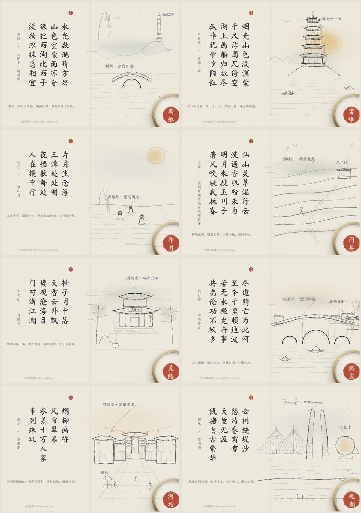

# 杭州速写本 · Hangzhou Sketchbook

> 一本摊开在杭州的速写本。八页 **three.js 实时水墨线稿**，从断桥的残雪画到钱塘的夜潮。
> 以代码为墨，以屏幕为纸。


一个致敬 [MengTo / threeui sketchbook](https://threeui.com/landing-pages/meng-to-sketchbook-landing-page) 手翻速写本气质的杭州主题落地页。保留原版纸张质感、曲面翻页与可拖拽放大镜，但插图不再是预渲染 PNG —— 每一根墨线都由 three.js 实时绘出，并带着轻微的「呼吸」。城市内容全部换成杭州：地标、街区、文化意象与文案，配真实咏杭州古诗。

## 线上演示

- **Vercel（production）**：<https://sonic-comet-snlyrjh.tmp.now>
  - 匿名临时部署，约 60 分钟后过期；认领后可持久保留：
    <https://vercel.com/claim-deployment?code=c0858fc4-4822-4dd2-bbcb-553ffd0f4e0f>
- **源码**：<https://github.com/dingyi/hangzhou-sketchbook>

## 八页

| 序 | 页 | 景 | 诗 |
| --- | --- | --- | --- |
| 壹 | 断桥残雪 | 白堤 · 北山街 | 苏轼《饮湖上初晴后雨》 |
| 贰 | 雷峰夕照 | 夕照山 · 南山路 | 尹廷高《雷峰夕照》 |
| 叁 | 三潭印月 | 小瀛洲 · 湖心 | 张宁《三潭印月》 |
| 肆 | 龙井问茶 | 狮峰山 · 龙井村 | 苏轼《次韵曹辅寄壑源试焙新芽》 |
| 伍 | 灵隐钟声 | 灵隐寺 · 飞来峰 | 宋之问《灵隐寺》 |
| 陆 | 运河人家 | 拱宸桥 · 桥西直街 | 皮日休《汴河怀古》 |
| 柒 | 河坊街市 | 河坊街 · 南宋御街 | 柳永《望海潮》 |
| 捌 | 钱塘新潮 | 城市阳台 · 钱塘江 | 柳永《望海潮》 |



## 交互

- **曲面翻页**：拖动书页、左右箭头、方向键、目录跳转。掀起的书页是 18 条嵌套 strips 组成的真实曲面（移植自原版），带光照渐变与中缝阴影。
- **放大镜**：可拖拽的放大镜实时放大笔触，翻页时被书页推开（触屏自动隐藏）。
- **画册工具条**：缩放、放大镜开关、线条呼吸开关、**墨色浓淡滑杆**（实时改变墨线浓度并重拍快照）、收藏当前页 PNG。
- **纸声**：WebAudio 合成的翻页纸声，默认开启，顶栏一键静音并显示状态。
- **滚动叙事**：湖上四季卡片、关于此册、目录、跋尾印章盖印；固定导航带当前态与锚点偏移、顶部进度条、首屏远山底景视差。
- **无障碍**：完整尊重 `prefers-reduced-motion`（跳过开场 riffle、关闭线条呼吸、印章直显）；键盘可翻页；语义化标签与 `aria` 状态。


## 技术栈

- **[Vite](https://vite.dev)** + 原生 JavaScript（无框架）
- **[three.js](https://threejs.org)** `LineSegments2`（像素级线宽）+ 自定义墨线引擎：
  - 顶点静态手抖 + 低频 boil（线条呼吸），共享端点抖动一致，折线不断开
  - 程序化水彩晕染贴图（软边水痕）
  - `CanvasTexture` 手写题字（竖排诗笺 / 标注 / 朱文印），快照与实时画面完全一致
- **自托管子集字体**（零外部请求）：霞鹜文楷（正文）、马善政楷书（标题）、Caveat、Instrument Serif、Newsreader
- 响应式，桌面与移动均无横向溢出；生产构建控制台无错误无警告

## 本地运行

```bash
npm install
npm run dev        # 开发服务器 http://localhost:5173
npm run build      # 生产构建到 dist/
npm run preview    # 预览生产构建
npm run fonts      # 重新生成字体子集（需 Python fonttools + brotli）
```

调试参数：`?shot=N` 直达第 N 页，`?turn=0.4` 定格翻页进度，`?nointro` 跳过开场。

## 项目结构

```
src/
  three/
    ink.js        墨线 / 水彩 / 题字 / 印章引擎
    scenes.js     八页杭州构图与通用笔法（塔 / 桥 / 民居 / 乌篷船 / 柳 / 远山）
    stage.js      渲染台：场景装配、实时呼吸、快照、浓淡、视差
    ambient.js    首屏远山薄雾底景
  book/
    turn.js       曲面翻页引擎
    loupe.js      可拖拽放大镜
    sound.js      翻页纸声（WebAudio 合成）
  content.js      文案与咏杭州古诗
  svg.js          四季小景 / 桂花 / 印章 / 图标
  main.js         装配与交互
  style.css       纸与墨的视觉语言
scripts/
  subset-fonts.mjs  扫描源码用字，子集化字体
public/fonts/       自托管 woff2
```

## 字体与致谢

字体均按 [SIL Open Font License 1.1](https://openfontlicense.org/) 使用，已子集化以减小体积：

- [霞鹜文楷 / LXGW WenKai](https://github.com/lxgw/LxgwWenKai)
- [Ma Shan Zheng](https://fonts.google.com/specimen/Ma+Shan+Zheng)
- [Caveat](https://fonts.google.com/specimen/Caveat)
- [Instrument Serif](https://fonts.google.com/specimen/Instrument+Serif) · [Newsreader](https://fonts.google.com/specimen/Newsreader)

页面结构、曲面翻页与放大镜交互致敬 [Meng To](https://meng.to) 的 [threeui sketchbook](https://github.com/MengTo/threeui)。所引诗词为公共领域的古典诗句。

## 许可

代码以 [MIT](LICENSE) 许可发布；字体见上各自 OFL 许可。